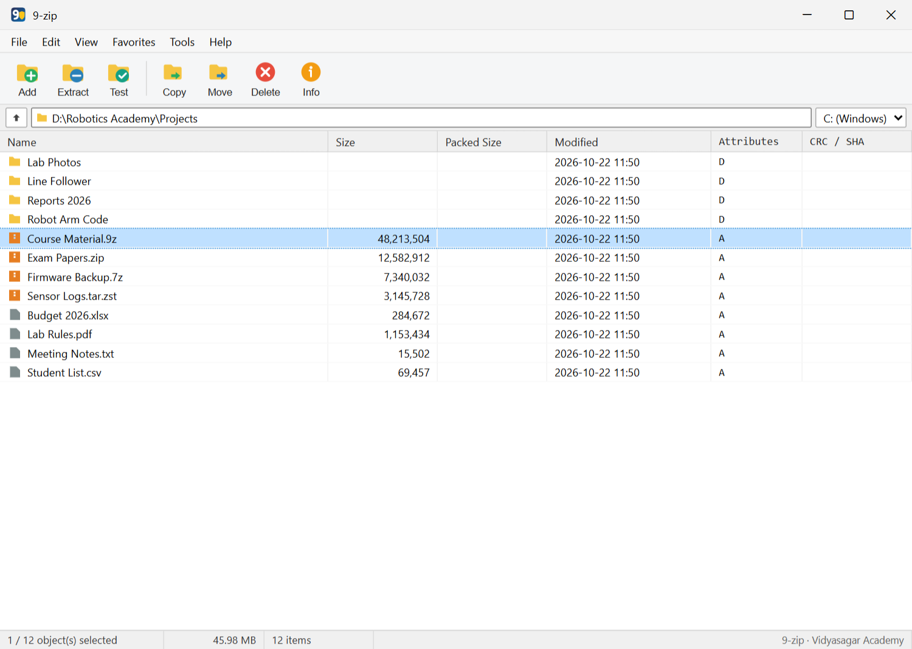
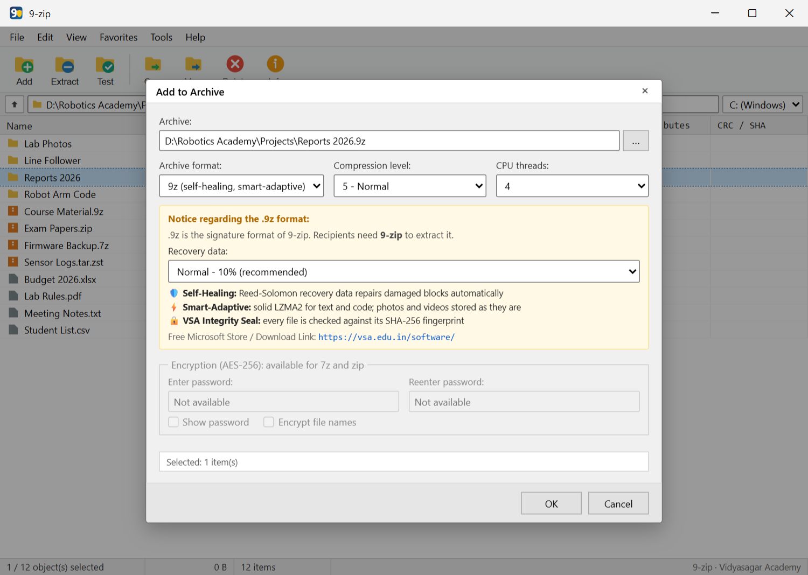
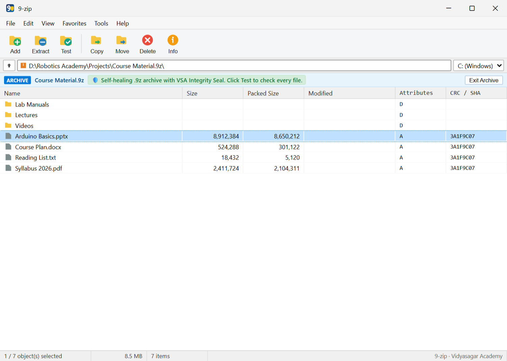
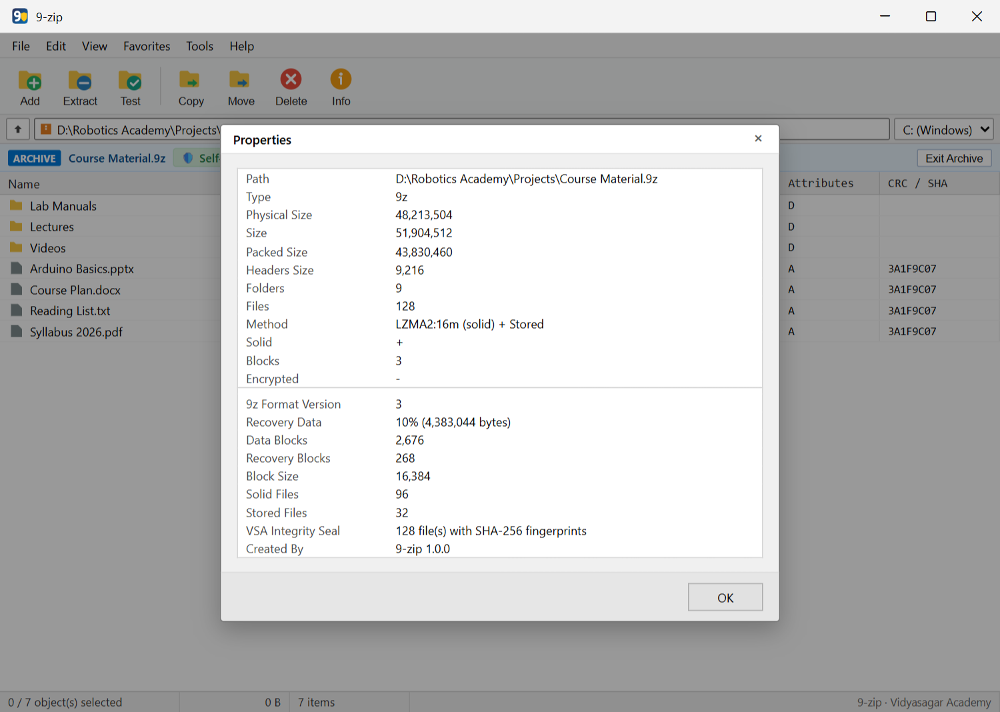

# 🏛️ Vidyasagar Academy — Software Catalog

A curated showcase of desktop applications, operating systems, mobile utilities, and educational software engineered by **Prof. Dattaraj S. Vidyasagar & Prof. Yash D. Vidyasagar** for **Vidyasagar Academy**.

🌐 **Official Website:** [https://vsa.edu.in/](https://vsa.edu.in/) • ✉️ **Inquiries:** [softinquiry@vsa.edu.in](mailto:softinquiry@vsa.edu.in)

---

## 📑 Software Categories

1. [📦 Archive & Compression Utilities](#-archive--compression-utilities)
   - [9-zip — Windows Archive Manager](#9-zip--windows-archive-manager)
2. [💾 Backup & Synchronization](#-backup--synchronization)
   - [Relax — Your data is safe!](#relax--your-data-is-safe)
3. [🎓 Classroom & Education](#-classroom--education)
   - [Observer — Classroom Monitoring & Testing](#observer--classroom-monitoring--testing)
4. [🔌 Electronics & Circuit Simulation](#-electronics--circuit-simulation)
   - [VSA Simulator — Circuit & Microcontroller Simulator](#vsa-simulator--circuit--microcontroller-simulator)
5. [🖥️ Operating Systems & Low-Level Systems *(Coming Soon)*](#-operating-systems--low-level-systems)
6. [📱 Mobile Applications *(Coming Soon)*](#-mobile-applications)
7. [💼 Institutional & Business Management *(Coming Soon)*](#-institutional--business-management)

---

## 📦 Archive & Compression Utilities

### 9-zip — Windows Archive Manager

**Source Code Repository:** [github.com/dsvakola/9-zip](https://github.com/dsvakola/9-zip)  
**SourceForge Download:** [sourceforge.net/projects/ninezip](https://sourceforge.net/projects/ninezip/)  
**Current Version:** `v1.2.0` • **Platform:** Windows 10 & 11 (64-bit)  
**Technology Stack:** Tauri v2, Rust (MSVC), Vanilla TypeScript (strict)  
**License:** [GNU General Public License v3.0 (GPL-3.0-only)](https://github.com/dsvakola/9-zip/blob/main/LICENSE)

#### 📖 Overview

**9-zip** is a modern, ultra-lightweight desktop archive manager for Windows. Built as an open-source, memory-safe alternative to legacy tools like 7-Zip and WinRAR, 9-zip pairs a high-performance native Rust core with a lightweight Tauri v2 frontend utilizing Windows' built-in WebView2 runtime (no bundled Chromium bloat). 

It features per-monitor high-DPI scaling (crisp rendering from 100% to 300%), native Windows shell context menu integration (`Add to archive...`, `Extract here`, `Test archive`), and multithreaded solid compression designed to harness all CPU cores.

#### 🛡️ The Self-Healing `.9z` Format

In addition to traditional formats, 9-zip introduces **`.9z`**, an innovative archive format engineered around three core principles:

1. **Self-Healing via Reed-Solomon Error Correction:** `.9z` archives store distributed recovery shards directly within the container. If an archive experiences corruption from bad storage sectors, bit-rot, or interrupted downloads, 9-zip automatically reconstructs the corrupted data blocks on-the-fly during extraction (configurable: Low 5%, Normal 10%, High 20% parity).
2. **Smart-Adaptive Compression:** Text, code, and documents are sorted by type and packed into solid LZMA2 blocks for maximum compression ratios. Pre-compressed files (JPEG, MP4, MKV, etc.) are detected and stored without wasting CPU cycles.
3. **VSA Integrity Seal:** Every file in a `.9z` archive carries a SHA-256 fingerprint verified whenever the archive is tested or unpacked.

#### 🗂️ Supported Archive Formats

| # | Format | Extension | Method | Integrity & Error Detection |
|---|---|---|---|---|
| 1 | **9Z** | `.9z` | Solid LZMA2, smart-adaptive | SHA-256 per file, CRC32 per block, **automatic self-repair** |
| 2 | **ZIP** | `.zip` | Deflate, optional AES-256 encryption | CRC32 |
| 3 | **7Z** | `.7z` | Solid LZMA2, optional AES-256 encryption | CRC32 |
| 4 | **TAR** | `.tar` | Uncompressed container | Header checksums |
| 5 | **GZIP** | `.tar.gz` | Deflate | CRC32 |
| 6 | **BZIP2** | `.tar.bz2` | Burrows-Wheeler | Block CRC |
| 7 | **XZ** | `.tar.xz` | LZMA2 | CRC64 |
| 8 | **ZSTD** | `.tar.zst` | Zstandard | Content checksum |
| 9 | **LZ4** | `.tar.lz4` | LZ4 framing | Content checksum |
| 10 | **BROTLI** | `.tar.br` | Brotli web compression | Content verification |

---

#### 📸 Screenshots

| Main File Manager Window | Add to Archive (Reed-Solomon Settings) |
|:---:|:---:|
|  |  |

| Archive Inspection & Self-Healing Indicator | Archive Properties & VSA Integrity Seal |
|:---:|:---:|
|  |  |

---

## 💾 Backup & Synchronization

### Relax — Your data is safe!

**Project Page:** [github.com/dsvakola/Relax](https://github.com/dsvakola/Relax)  
**Availability:** Coming soon to the Microsoft Store (Rs. 299 one-time, 7-day free trial) • **Platform:** Windows 10 & 11 (64-bit)  
**Current Version:** `v2.1.0`  
**Technology Stack:** Tauri v2, Rust (MSVC), Vanilla TypeScript (strict)  
**Privacy:** [Privacy Policy](https://github.com/dsvakola/Relax/blob/main/PRIVACY.md) • **Licence:** [NOTICE](https://github.com/dsvakola/Relax/blob/main/NOTICE.txt)

#### 📖 Overview

**Relax** keeps important files safe on USB drives, external hard disks and other folders, simply and reliably, without the cloud. It compares two folders, shows every difference in a clear preview, and changes nothing until you click **Synchronize**. It works 100% offline: no account, no ads, no tracking, and nothing is ever sent anywhere.

- **Compare and preview:** compare by date and size, or byte by byte, and see every difference side by side before anything happens. Right-click any item to change what happens to it.
- **Four ways to back up:** *Update* (incremental: copy only new and changed files, delete nothing), *Mirror* (the backup becomes an exact copy), *Two-way* (keep two folders the same in both directions) and *Custom* (decide for each kind of difference).
- **Safe by design:** every file is copied under a temporary name and renamed only when complete; deleted and replaced files go to the Recycle Bin or a versions folder; nothing is deleted when a source folder or drive is missing or empty; free space is checked first.
- **Convenient:** saved backup jobs you open with one click, scheduled automatic backups (daily, weekly or at sign-in) through Windows Task Scheduler, include/exclude filters, pause and cancel, and a log of every backup.
- **Light and fast:** a native Rust engine with a preview grid that handles hundreds of thousands of files, a small installer, and a runtime built in, so it runs on any Windows 10/11 PC.

---
## 🎓 Classroom & Education

### Observer — Classroom Monitoring & Testing

**Project Page:** [github.com/dsvakola/observer](https://github.com/dsvakola/observer)  
**Availability:** Coming soon to the Microsoft Store • **Platform:** Windows 10 & 11 (64-bit)  
**Editions:** Observer Faculty (teacher PC, paid) • Observer Student (student PCs, free)  
**Technology Stack:** Tauri v2, Rust (MSVC), WebView2  
**Privacy:** [Privacy Policy](https://github.com/dsvakola/observer/blob/main/PRIVACY.md)

#### 📖 Overview

**Observer** lets a teacher run a whole computer lab from one PC: live pictures of every student screen, a sharp low-delay big view, remote control, screen lock, messages, file transfer, help calls, stars, groups, and switching PCs on and off over the network. It also includes question banks and tests, with marking and records for every student.

Everything stays inside the school's own network: no internet is needed, and every link between the PCs is encrypted.

| Main Window | Big Live View |
|:---:|:---:|
|  |  |

---

## 🔌 Electronics & Circuit Simulation

### VSA Simulator — Circuit & Microcontroller Simulator

**Project Page:** [github.com/dsvakola/VSA-Simulator](https://github.com/dsvakola/VSA-Simulator)  
**Availability:** Coming soon to the Microsoft Store • **Platform:** Windows 10 & 11 (64-bit)  
**Technology Stack:** Tauri v2, Rust (MSVC), Vanilla TypeScript (strict)  
**License:** [GNU General Public License v3.0](https://github.com/dsvakola/VSA-Simulator/blob/main/LICENSE)

#### 📖 Overview

**VSA Simulator** lets school and college students, researchers and hobbyists build a circuit on a virtual breadboard, load the program they wrote in the Arduino IDE, Keil or Thonny, and watch it run: LEDs glow, motors turn, displays show text, sensors respond, and parts that get too much current burn out. It runs your real compiled program, works fully offline, and needs no account.

- **Boards:** Arduino Uno, Nano and Mega 2560, ESP32, ESP8266 and Raspberry Pi Pico W (Arduino or MicroPython).
- **Chips:** 8051/8052 (AT89C51/52, AT89S51/52) and ATmega8, ATmega16, ATmega32 and ATmega128, bare or on development boards. The ATmega examples come in two styles, Arduino IDE and plain C for AVR Studio 4/6, so teachers can show that the ATmega is the heart of the Arduino boards.
- **Parts:** power supplies, resistors, switches, LEDs, displays (7-segment, I2C LCD, OLED), sensors, motors, servos, relays, transistors and more, with real breadboard behaviour.
- **Learning:** 214 ready-made examples with tidy circuits and fully commented code (File > Examples), a Serial Monitor / Shell that shows the printed output, a source-code viewer with a Copy button, and a built-in User Guide.
- **Light and private:** a download of only a few MB, fully offline, no account, nothing sent anywhere.

**Source code and examples:** [github.com/dsvakola/VSA-Simulator](https://github.com/dsvakola/VSA-Simulator) • **Website:** [vsa.edu.in](https://vsa.edu.in/)

---

## 🖥️ Operating Systems & Low-Level Systems

*Details and repository links for **Vidyasagar OS (বিদ্যাसागर)** will be published here soon.*

---

## 📱 Mobile Applications

*Details and repository links for **Pixel Lock** and related mobile utilities will be published here soon.*

---

## 💼 Institutional & Business Management

*Details and repository links for **AshtaLakshmi Billing Software**, **VRA Academy Manager**, and **ExamSphere** will be published here soon.*

---

## ⚖️ License & Copyright

All catalog listings and branding are Copyright © 2026 **Prof. Dattaraj S. Vidyasagar & Prof. Yash D. Vidyasagar**, for **Vidyasagar Academy**. Individual applications are governed by their respective licenses (e.g. GNU GPLv3 for 9-zip) as specified in their project repositories.
