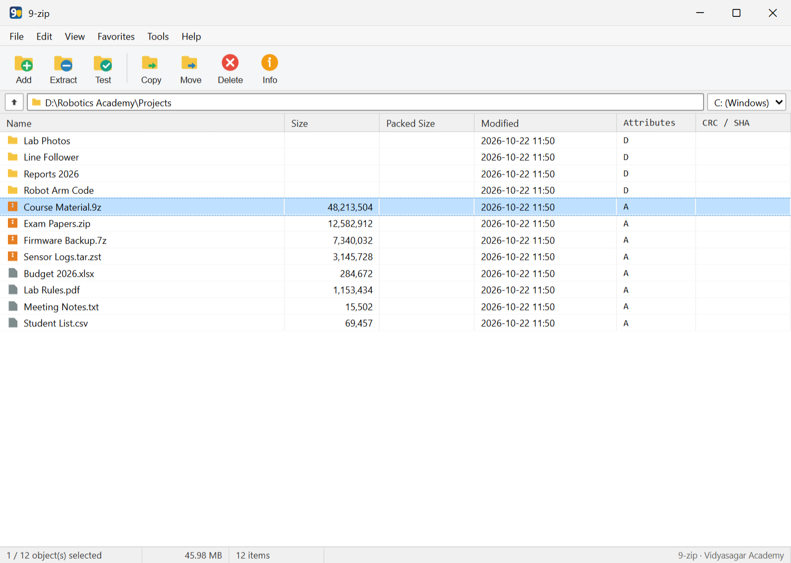
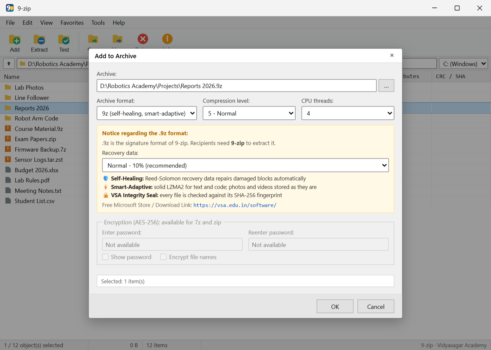
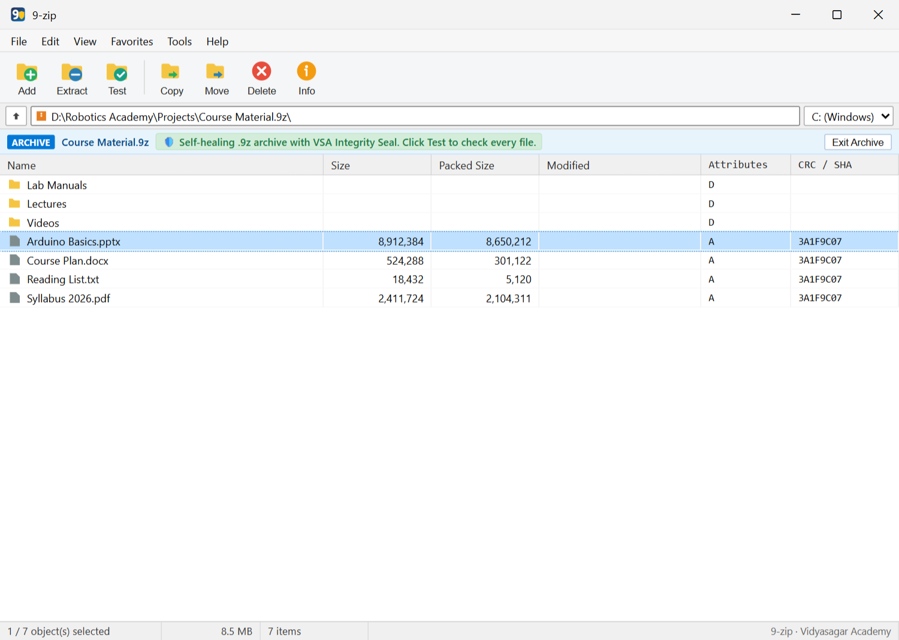
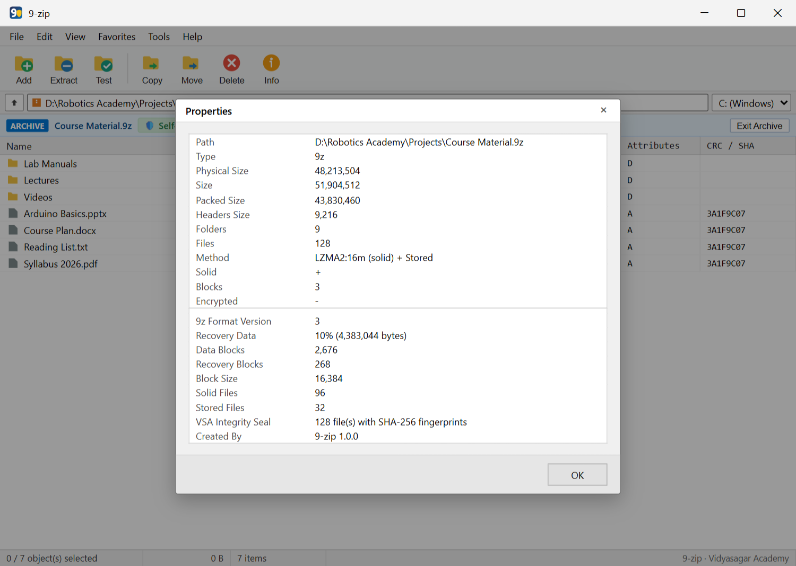

# 🏛️ Vidyasagar Academy — Software Catalog

A curated showcase of desktop applications, operating systems, mobile utilities, and educational software engineered by **Prof. Dattaraj S. Vidyasagar & Prof. Yash D. Vidyasagar** for **Vidyasagar Academy**.

🌐 **Official Website:** [https://vsa.edu.in/](https://vsa.edu.in/) • ✉️ **Inquiries:** [softinquiry@vsa.edu.in](mailto:softinquiry@vsa.edu.in)

---

## 📑 Software Categories

1. [📦 Archive & Compression Utilities](#-archive--compression-utilities)
   - [9-zip — Windows Archive Manager](#9-zip--windows-archive-manager)
2. [🖥️ Operating Systems & Low-Level Systems *(Coming Soon)*](#-operating-systems--low-level-systems)
3. [📱 Mobile Applications *(Coming Soon)*](#-mobile-applications)
4. [💼 Institutional & Business Management *(Coming Soon)*](#-institutional--business-management)

---

## 📦 Archive & Compression Utilities

### 9-zip — Windows Archive Manager

**Source Code Repository:** [github.com/dsvakola/9-zip](https://github.com/dsvakola/9-zip)  
**SourceForge Download:** [sourceforge.net/projects/ninezip](https://sourceforge.net/projects/ninezip/)  
**Current Version:** `v1.2.0` • **Platform:** Windows 10 & 11 (64-bit)  
**Technology Stack:** Tauri v2, Rust (MSVC), Vanilla TypeScript (strict)  
**License:** [GNU General Public License v3.0 (GPL-3.0-only)](https://github.com/dsvakola/9-zip/blob/main/LICENSE)

#### 📖 Overview

**9-zip** is a modern, ultra-lightweight desktop archive manager for Windows. Built as an open-source, memory-safe alternative to legacy tools like 7-Zip and WinRAR, 9-zip pairs a high-performance native Rust core with a lightweight Tauri v2 frontend utilizing Windows' built-in WebView2 runtime (no bundled Chromium bloat). 

It features per-monitor high-DPI scaling (crisp rendering from 100% to 300%), native Windows shell context menu integration (`Add to archive...`, `Extract here`, `Test archive`), and multithreaded solid compression designed to harness all CPU cores.

#### 🛡️ The Self-Healing `.9z` Format

In addition to traditional formats, 9-zip introduces **`.9z`**, an innovative archive format engineered around three core principles:

1. **Self-Healing via Reed-Solomon Error Correction:** `.9z` archives store distributed recovery shards directly within the container. If an archive experiences corruption from bad storage sectors, bit-rot, or interrupted downloads, 9-zip automatically reconstructs the corrupted data blocks on-the-fly during extraction (configurable: Low 5%, Normal 10%, High 20% parity).
2. **Smart-Adaptive Compression:** Text, code, and documents are sorted by type and packed into solid LZMA2 blocks for maximum compression ratios. Pre-compressed files (JPEG, MP4, MKV, etc.) are detected and stored without wasting CPU cycles.
3. **VSA Integrity Seal:** Every file in a `.9z` archive carries a SHA-256 fingerprint verified whenever the archive is tested or unpacked.

#### 🗂️ Supported Archive Formats

| # | Format | Extension | Method | Integrity & Error Detection |
|---|---|---|---|---|
| 1 | **9Z** | `.9z` | Solid LZMA2, smart-adaptive | SHA-256 per file, CRC32 per block, **automatic self-repair** |
| 2 | **ZIP** | `.zip` | Deflate, optional AES-256 encryption | CRC32 |
| 3 | **7Z** | `.7z` | Solid LZMA2, optional AES-256 encryption | CRC32 |
| 4 | **TAR** | `.tar` | Uncompressed container | Header checksums |
| 5 | **GZIP** | `.tar.gz` | Deflate | CRC32 |
| 6 | **BZIP2** | `.tar.bz2` | Burrows-Wheeler | Block CRC |
| 7 | **XZ** | `.tar.xz` | LZMA2 | CRC64 |
| 8 | **ZSTD** | `.tar.zst` | Zstandard | Content checksum |
| 9 | **LZ4** | `.tar.lz4` | LZ4 framing | Content checksum |
| 10 | **BROTLI** | `.tar.br` | Brotli web compression | Content verification |

---

#### 📸 Screenshots

| Main File Manager Window | Add to Archive (Reed-Solomon Settings) |
|:---:|:---:|
|  |  |

| Archive Inspection & Self-Healing Indicator | Archive Properties & VSA Integrity Seal |
|:---:|:---:|
|  |  |

---

## 🖥️ Operating Systems & Low-Level Systems

*Details and repository links for **Vidyasagar OS (বিদ্যাसागर)** will be published here soon.*

---

## 📱 Mobile Applications

*Details and repository links for **Pixel Lock** and related mobile utilities will be published here soon.*

---

## 💼 Institutional & Business Management

*Details and repository links for **AshtaLakshmi Billing Software**, **VRA Academy Manager**, and **ExamSphere** will be published here soon.*

---

## ⚖️ License & Copyright

All catalog listings and branding are Copyright © 2026 **Prof. Dattaraj S. Vidyasagar & Prof. Yash D. Vidyasagar**, for **Vidyasagar Academy**. Individual applications are governed by their respective licenses (e.g. GNU GPLv3 for 9-zip) as specified in their project repositories.
